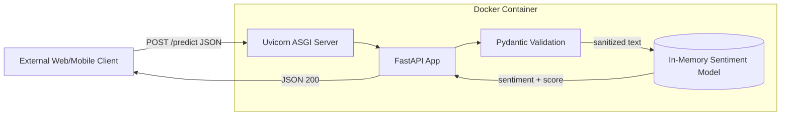

# ml-sentiment-api

A production-ready REST API that serves a sentiment analysis model (TF-IDF + Logistic Regression) built with **FastAPI**, validated with **Pydantic**, packaged with a **multi-stage Docker build**, orchestrated with **Docker Compose**, and tested with **pytest**.

## Table of Contents
1. [Project Overview](#project-overview)
2. [Architecture](#architecture)
3. [Project Structure](#project-structure)
4. [Prerequisites](#prerequisites)
5. [Setup Instructions (Local)](#setup-instructions-local)
6. [Docker Build/Run Commands](#dockerbuildrun-commands)
7. [API Usage](#api-usage)
8. [Testing Execution](#testing-execution)
9. [Configuration](#configuration)
10. [Design Decisions](#design-decisions)
11. [CI/CD Readiness](#cicd-readiness)

## Project Overview
The service exposes a trained sentiment classifier over HTTP so any web, mobile or microservice client can consume predictions without knowing anything about the underlying ML code.

| Endpoint | Method | Purpose |
|----------|--------|---------|
| `/health` | GET | Readiness/liveness probe -> `{"status": "healthy"}` |
| `/predict` | POST | Classify text -> `{"sentiment": "...", "score": 0.93}` |
| `/docs` | GET | Interactive Swagger UI (OpenAPI) |

Key properties: model loaded once at startup (lifespan), strict input validation (422 on bad input), generic 500 errors with no stack-trace leakage, INFO logging to stdout, all config from environment variables.

## Architecture


## Project Structure
```
ml-sentiment-api/
├── app/
│   ├── __init__.py
│   └── main.py              # FastAPI application and routes
├── model/
│   ├── train_model.py       # Script that generates the model artifact
│   └── sentiment_model.pkl  # Serialized model artifact
├── tests/
│   ├── __init__.py
│   └── test_api.py          # Unit + integration tests (pytest)
├── .github/workflows/ci.yml # GitHub Actions pipeline
├── .env.example             # Environment variable template
├── docker-compose.yml       # Orchestration
├── Dockerfile               # Multi-stage build
├── requirements.txt         # Pinned dependencies
└── README.md
```

## Prerequisites
- Python 3.11+ (3.12 also works)
- Docker 24+ and Docker Compose v2
- Git

## Setup Instructions (Local)
```bash
git clone https://github.com/<your-username>/ml-sentiment-api.git
cd ml-sentiment-api

python -m venv venv
source venv/bin/activate          # Windows: venv\Scripts\activate
pip install -r requirements.txt

cp .env.example .env              # Windows: copy .env.example .env
python model/train_model.py       # (re)generate model/sentiment_model.pkl

# Run the server (loads values from .env)
set -a && source .env && set +a
uvicorn app.main:app --host $UVICORN_HOST --port $UVICORN_PORT --reload
```
Open http://localhost:8000/docs

## Docker Build/Run Commands
**One command (recommended):**
```bash
cp .env.example .env
docker compose up --build
```
The API is then available at http://localhost:8000.

Other useful commands:
```bash
docker compose up -d --build        # run in background
docker compose logs -f sentiment_api
docker compose down                 # stop and remove
docker image ls ml-sentiment-api    # check image size

# Plain Docker (without compose)
docker build -t ml-sentiment-api .
docker run --rm -p 8000:8000 --env-file .env.example ml-sentiment-api
```

## API Usage
**Health check**
```bash
curl http://localhost:8000/health
```
```json
{"status": "healthy"}
```

**Predict**
```bash
curl -X POST http://localhost:8000/predict \
  -H "Content-Type: application/json" \
  -d '{"text": "I love this platform!"}'
```
```json
{"sentiment": "positive", "score": 0.8}
```

**Validation errors (HTTP 422)**
```bash
curl -X POST http://localhost:8000/predict -H "Content-Type: application/json" -d '{"text": ""}'
curl -X POST http://localhost:8000/predict -H "Content-Type: application/json" -d '{"text": 12345}'
curl -X POST http://localhost:8000/predict -H "Content-Type: application/json" -d '{}'
```

**Internal failure (HTTP 500)** - generic message only, details are in server logs:
```json
{"detail": "Internal Server Error"}
```

## Testing Execution
Locally:
```bash
pytest tests/ -v
```
Inside the running container:
```bash
docker compose up -d --build
docker compose exec sentiment_api pytest tests/
```
The suite covers: `/health`, `/docs`, `/predict` happy paths, empty / blank / wrong-type / missing / oversized payloads (422), inference failure and unloaded model (generic 500, no leaks).

## Configuration
| Variable | Default | Description |
|----------|---------|-------------|
| `MODEL_PATH` | `./model/sentiment_model.pkl` | Path to serialized model |
| `UVICORN_HOST` | `0.0.0.0` | Bind address |
| `UVICORN_PORT` | `8000` | Bind port |
| `LOG_LEVEL` | `INFO` | Python logging level |

No secrets are committed; `.env` is git-ignored.

## Design Decisions
- **Lifespan loading**: the model is deserialized once at startup, not per request, avoiding per-request latency.
- **Pydantic validation**: `min_length=1`, `max_length=5000`, blank-string rejection and strict `str` typing stop malformed data before it reaches the model.
- **Safe errors**: a global exception handler and a try/except around inference return `{"detail": "Internal Server Error"}`; full stack traces go only to logs (`exc_info=True`).
- **Multi-stage Docker**: the builder stage installs dependencies into a venv and trains the model (so the pickle matches the installed scikit-learn); the runtime stage copies only the venv, model and app code, runs as a non-root user, and has a `HEALTHCHECK`.
- **Score**: the highest class probability from `predict_proba` (0-1 confidence).

## CI/CD Readiness
The repo is pipeline-ready: the Dockerfile builds with no user input and `pytest` exits with code `0` on success. A working GitHub Actions workflow is included at `.github/workflows/ci.yml`:

1. **test** - checkout, set up Python 3.11, install `requirements.txt`, train the model, run `pytest`.
2. **docker** (needs `test`) - build the multi-stage image, run the container, poll `/health`, smoke-test `/predict`.
3. **publish** (needs `docker`, only on pushes to `main`) - log in to GitHub Container Registry with the built-in `GITHUB_TOKEN` and push `ghcr.io/<owner>/ml-sentiment-api:latest` and `:<commit-sha>`.

Pull requests run jobs 1-2 only, so broken code never reaches the registry. A deployment stage (e.g. Kubernetes or a VM running `docker compose pull && docker compose up -d`) can be added after `publish`, using `/health` as the readiness probe.
